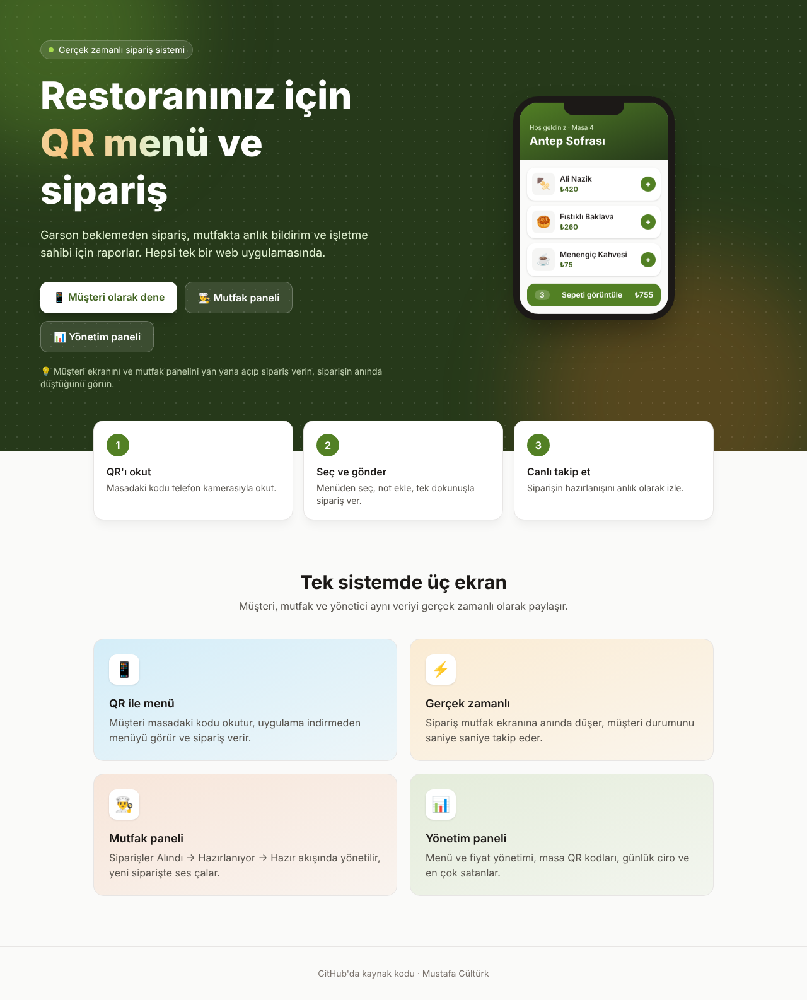
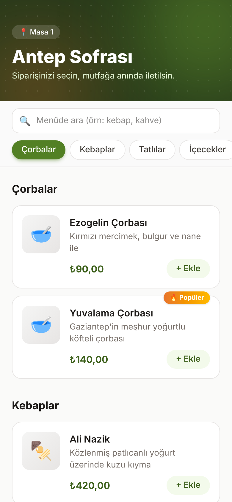
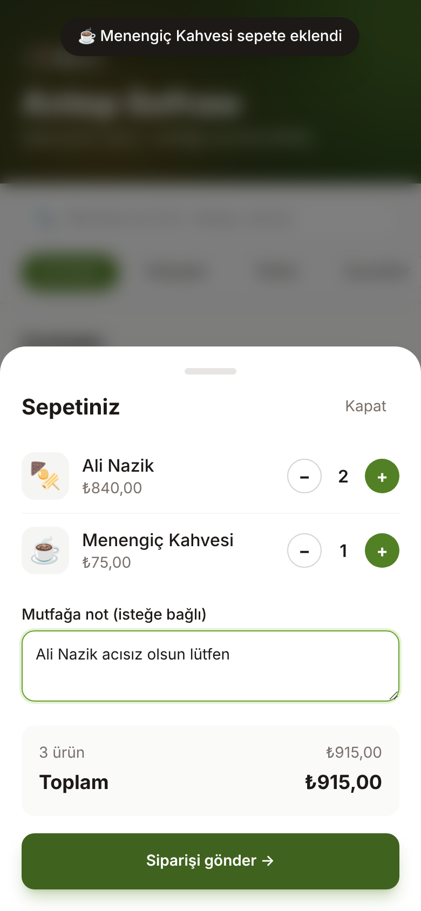
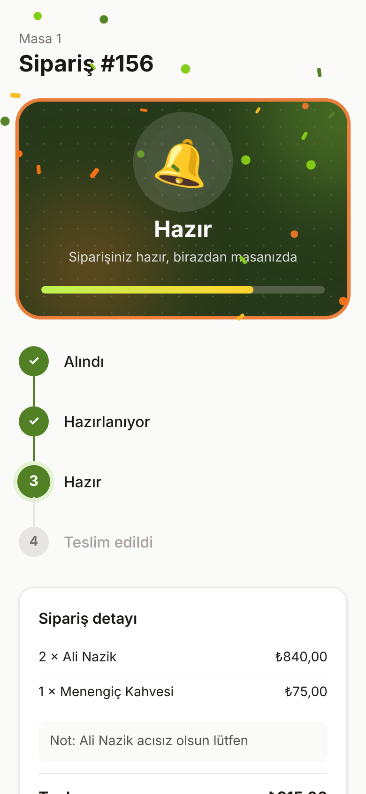
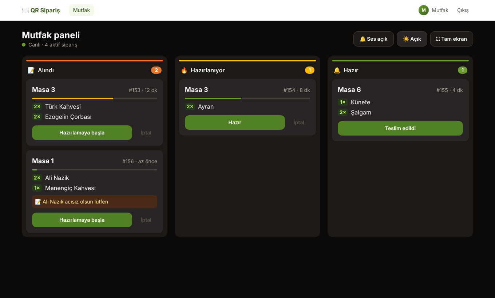
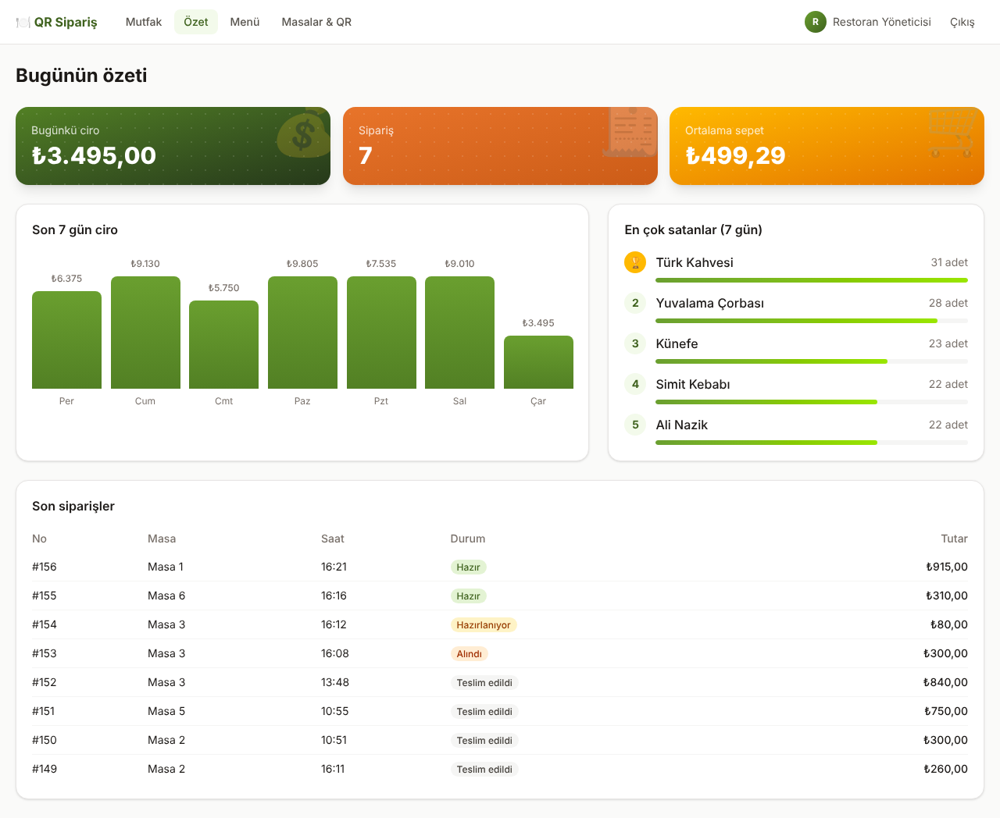
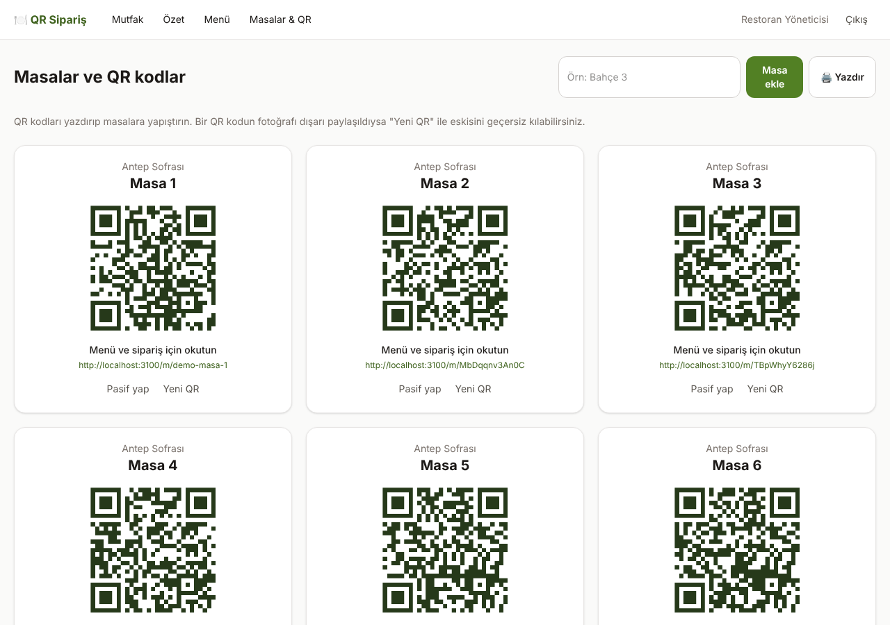

# QR Sipariş: Restoran QR Menü ve Sipariş Sistemi




Restoranlar için uçtan uca bir sipariş sistemi. Müşteri masadaki QR kodu okutur, uygulama indirmeden menüyü görür ve sipariş verir. Sipariş **anında** mutfak ekranına düşer. Mutfak siparişi ilerlettikçe müşteri durumu telefonundan **canlı** takip eder. İşletme sahibi de menüyü, masaları ve günlük ciroyu yönetim panelinden yönetir.

<p>
  
  
  
</p>



## Özellikler

**Müşteri (mobil)**
- QR kod ile masaya özel menü, kaydırdıkça kendini vurgulayan kategori sekmeleri
- Türkçe karakter duyarsız menü araması ("cay" yazınca "Çay" bulunur)
- Son 7 günün en çok satanlarına otomatik "🔥 Popüler" rozeti
- Animasyonlu sepet, ürün adedi ve mutfağa not. Sepet sayfa yenilense de kaybolmaz.
- Sipariş durumunu gerçek zamanlı takip (Alındı → Hazırlanıyor → Hazır → Teslim edildi), tahmini süre, durum değişince titreşim, sipariş hazır olunca konfeti

**Mutfak paneli**
- Siparişler üç sütunlu panoda canlı akar, yeni siparişte sesli uyarı verilir
- Tek tıkla durum ilerletme ve iyimser arayüz güncellemesi
- Her siparişte bekleme süresi çubuğu (yeşil → sarı → kırmızı), 20 dakikayı geçenler uyarıyla vurgulanır
- Loş mutfak ortamı için karanlık tema ve tam ekran modu

**Yönetim paneli**
- Günlük ciro, sipariş sayısı, ortalama sepet, animasyonlu 7 günlük ciro grafiği ve en çok satanlar
- Kategori ve ürün ekleme, düzenleme, silme, "tükendi" olarak işaretleme
- Masa ekleme, yazdırılabilir QR kodlar, sızan QR kodu tek tıkla geçersiz kılma





## Teknik detaylar

| Alan | Kullanılan |
|------|-----------|
| Framework | Next.js 15 (App Router, Server Components, Server Actions) |
| Dil | TypeScript (strict) |
| Veritabanı | PostgreSQL + Drizzle ORM, versiyonlu migration'lar |
| Gerçek zamanlı | Server-Sent Events (SSE) |
| Kimlik doğrulama | bcrypt + JWT (jose), httpOnly cookie, rol tabanlı yetki (yönetici / mutfak) |
| Doğrulama | Zod |
| Arayüz | Tailwind CSS 4 |
| Test | Vitest, gerçek PostgreSQL üzerinde entegrasyon testleri |
| CI/CD | GitHub Actions (lint, tip kontrolü, test, build), Docker |

### Öne çıkan mühendislik kararları

- **Fiyatlar sunucuda hesaplanır.** İstemci sadece ürün ID'si ve adet gönderir. Toplam tutar veritabanındaki fiyattan hesaplanır, böylece kimse isteği değiştirerek ucuza sipariş veremez.
- **Sipariş anındaki fiyat saklanır.** Ürün fiyatı sonradan değişse de eski siparişlerin tutarı bozulmaz.
- **Para birimi kuruş cinsinden tam sayıdır.** Ondalık sayı yuvarlama hataları oluşmaz.
- **Durum makinesi.** Siparişler yalnızca izin verilen sırayla ilerler (ör. "Alındı"dan doğrudan "Teslim edildi"ye geçilemez).
- **Eşzamanlılık kontrolü.** İki mutfak çalışanı aynı siparişe aynı anda basarsa güncellemelerden yalnızca biri başarılı olur (koşullu `UPDATE ... WHERE status = ?`).
- **Tahmin edilemez QR anahtarları.** QR kodda masa numarası değil rastgele bir anahtar bulunur. Sipariş takip linkleri de UUID'dir.
- **Saat dilimi.** Günlük raporlar veritabanında `Europe/Istanbul` saat dilimine göre hesaplanır.

## Kurulum

Gereksinimler: Node.js 22+, PostgreSQL 16 (veya Docker)

```bash
git clone https://github.com/mustafagulturk/qr-siparis.git
cd qr-siparis
npm install
cp .env.example .env          # DATABASE_URL ve SESSION_SECRET değerlerini düzenleyin

npm run db:migrate            # tabloları oluşturur
npm run db:seed               # örnek Gaziantep menüsü, masalar, demo hesaplar ve 7 günlük örnek sipariş
npm run dev                   # http://localhost:3000
```

Docker ile tek komutta çalıştırmak için:

```bash
docker compose up --build
docker compose exec app npm run db:seed
```

### Demo

| Ekran | Adres | Giriş |
|-------|-------|-------|
| Müşteri menüsü | `/m/demo-masa-1` | Gerekmez |
| Mutfak paneli | `/mutfak` | `mutfak@demo.com` / `demo1234` |
| Yönetim paneli | `/yonetim` | `yonetici@demo.com` / `demo1234` |

> İpucu: Müşteri ekranını telefonda, mutfak panelini bilgisayarda açıp sipariş verin. Siparişin anında düştüğünü görürsünüz.

### Testler

```bash
npm test          # TEST_DATABASE_URL ile ayrı bir test veritabanı kullanır
```

## Proje yapısı

```
src/
  app/
    m/[token]/          Müşteri menüsü ve sepet
    siparis/[id]/       Canlı sipariş takibi
    mutfak/             Mutfak paneli
    yonetim/            Özet, menü ve masa yönetimi (Server Actions)
    giris/              Personel girişi
    api/                Sipariş API'si ve SSE olay akışı
  db/                   Drizzle şeması, migration ve seed betikleri
  lib/                  İş mantığı (siparişler, raporlar, yetki, para)
tests/                  Entegrasyon ve birim testleri
drizzle/                SQL migration dosyaları
```

## Yol haritası

- [ ] Garson çağırma ve hesap isteme butonu
- [ ] Çoklu şube desteği
- [ ] Ürün fotoğrafı yükleme
- [ ] Çok sunuculu kurulum için SSE yerine Redis veya Postgres LISTEN/NOTIFY

## Lisans

MIT
